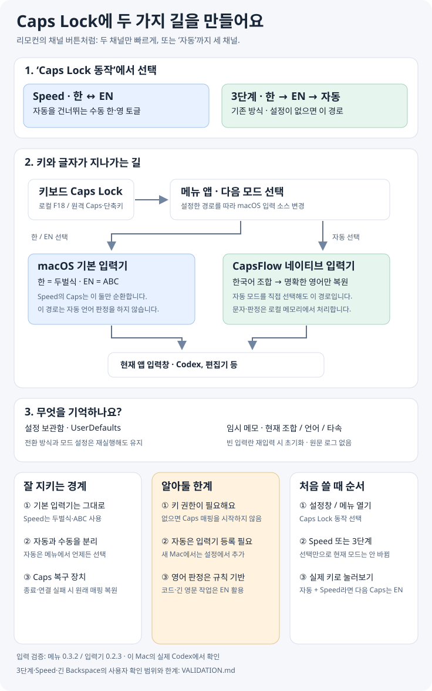

# CapsFlow

이 Mac에서 실행하는 한·영 입력 앱. Caps Lock을 **Speed: 한 ↔ EN** 또는 **3단계: 한 → EN → 자동**으로 설정할 수 있습니다.

<picture>
  <source media="(max-width: 480px)" srcset="docs/overview-mobile.svg" />
  
</picture>

설정창의 **Caps Lock 동작** 또는 메뉴바에서 선택하세요. 기본은 기존 3단계이며, 설정 변경은 현재 입력 모드를 바꾸지 않습니다. Speed 설정에서 수동으로 ‘자동’을 선택했다면 다음 Caps는 EN입니다. ‘Speed’는 한 번에 두 모드만 오가는 동작 이름으로, 속도 측정 수치를 뜻하지 않습니다. [검증 기록](VALIDATION.md) · [모바일 그림](docs/overview-mobile.svg)

## 현재 버전과 원격 접속 시 주의

메뉴 앱 **0.3.0** + 네이티브 입력기 **0.2.2**입니다. Speed 전환 규칙의 자동 검사는 통과했으나,
새 옵션의 물리 Caps Lock 동작은 아직 확인 전입니다.

현재 메뉴 앱은 Mac에 연결된 HID 키보드가 없으면 시작에 실패하고 재시도하면서 입력 소스를
두벌식으로 되돌릴 수 있습니다. 원격 접속만 하는 환경에서는 메뉴 앱을 종료한 뒤 macOS 입력 메뉴에서
**CapsFlow 한국어 우선**을 직접 선택하세요. 이 독립 입력기 상태에서 원격 Codex의
`dkssud` + Space → `안녕`을 사용자가 확인했습니다. 원격 Caps Lock 전달·Speed 토글까지
검증됐다는 뜻은 아닙니다. 메뉴 앱의 로그인 자동 실행을 켰다면 다시 실행될 때도 같은 제한이 적용됩니다.

## 입력기 0.2.2 · 표시와 삭제 상태 보완

전환 설정은 메뉴 앱 0.3.0에 추가했습니다. 네이티브 입력기 구성요소는 검증된 0.2.2를 유지합니다.

- 조합 중에는 지원되는 앱에 단일 얇은 밑줄·투명 배경을 명시하고 실제 선택 길이는 0으로 유지합니다.
- 글자를 전부 지우면 명시 영어 선택이 다음 단어로 넘어가지 않습니다. 빈 입력란으로 새 입력을
  시작할 때 최근 언어·타속 판단·직전 변환 상태를 초기화합니다.
- 수동 한글 선택은 해당 단어의 공백 확정까지 우선하여 자동 영어 판정이 덮어쓰지 않습니다.
- 마지막 조합 글자 삭제는 빈 문자열 확정이 아닌 빈 조합 갱신으로 처리합니다.
  추가 합성 Delete 없이 Backspace 한 번에 삭제합니다.
- 사용자가 실제 Codex에서 얇은 밑줄, 삭제 후 새 한글 입력, 마지막 `r`의 한 번 삭제를 확인했습니다.
  자세한 검사 범위와 앱별 한계는 `VALIDATION.md`를 따릅니다.

## 0.2.0 · 한국어 우선 네이티브 입력기

이 Mac에 0.2.0을 설치·활성화했고, 사용자가 실제 Codex에서 Caps 순환, 한·영 확정,
오른쪽 Option 선택, 빠른 다문장 입력, 잠시 멈춘 뒤 한글 이어쓰기가 정상임을 확인했습니다.

`자동`은 이제 ABC 입력 후 지우고 재입력하는 보조 기능이 아니라, 별도 **CapsFlow 한국어 우선**
입력 소스입니다. [Apple InputMethodKit](https://developer.apple.com/documentation/inputmethodkit)의
조합/확정 API를 사용합니다. 자동 모드에서는 기존 AX 조회·백스페이스·합성 키 재생 경로를 사용하지 않습니다.

- 기본은 두벌식 한글 조합입니다. 사전 밖 단어·Shift·단독 자모도 한글로 유지합니다.
  `r`은 `ㄱ`, `QKfmrp`는 `빠르게`입니다.
- `hello`, `API`, 주소·이메일·단위처럼 명확한 영어만 단어 확정 시 영어로 복원합니다.
  `go/해`처럼 양쪽 해석이 있으면 한국어를 기본으로 둡니다. 코드/영문 장문은 EN 모드를 권장합니다.
- 애매한 입력의 영어 후보는 작게 표시합니다. 조합 중 **오른쪽 Option / ⌘⌥Z**로 한·영을
  명시 선택할 수 있습니다. 후보 위치를 입력란이 제공하지 않으면 팝업만 생략하며 단축키는 유지합니다.
- 잠깐 멈춰도 현재 조합은 유지합니다. 확정된 한글 뒤에도 새 한글을 자연스럽게 이어 입력합니다.
  공백·닫는 기호에서 현재 조합만 확정하고 오른쪽 기존 단어는 교체하지 않습니다.
- ⌘⌥Z는 선택 문장의 두벌식 자판 변환도 지원합니다. 한글 선택은 영타로, 영타 선택은 한글로
  바꿉니다(번역/맞춤법 교정 아님). 지원되는 클라이언트의 정확한 선택 범위만 사용하며,
  선택 내용/범위를 확인하지 못하면 교체하지 않습니다. 마지막 변환 원문 한 건만 메모리에 둡니다.
- 타속은 개인의 한국어 입력 대비 평균 간격만 사용합니다. 긴 생각/휴식 간격은 제외합니다.
  속도만으로 영어를 선택하지 않으며, 덜 흔한 영어 사전 단어 + 최근 영어 연속 입력이 함께 있을 때만 보조합니다.
  간격 평균과 현재 조합은 메모리에서만 처리하며 원문 로그·원격 요청은 없습니다.

구성: 메뉴/Caps Lock 담당 `~/Applications/CapsFlow.app` + 조합 담당
`~/Library/Input Methods/CapsFlowInputMethod.app`. 기존 macOS 두벌식과 ABC는 삭제하거나 수정하지 않습니다.

검사/빌드:

```sh
./scripts/test.sh
./scripts/build.sh
zsh ./scripts/build-input-method.sh
```

새 입력기 등록·활성화는 사용자의 승인을 받은 뒤 사용자 Library의 Input Methods에 설치하고
`CapsFlowInputMethod --register <설치한 앱 경로>`로 등록 요청합니다. enable API의 성공 반환만으로
활성화 완료로 보지 않습니다. 이 Mac에서는 재로그인 후 **시스템 설정 → 키보드 → 입력 소스 편집 →
추가 → 한국어 → CapsFlow 한국어 우선 → 추가**가 필요했습니다. 이후 메뉴에서 자동을 선택하거나
`--activate`로 선택합니다. 추가 목록에도 보이지 않으면 로그아웃/로그인 후 다시 확인합니다.
활성 세션에서 재설치하기 전에는
ABC/두벌식으로 전환해 조합을 확정하고 기존 입력기 프로세스 종료를 확인해야 합니다.

되돌리기: 입력 메뉴에서 **두벌식 또는 ABC**를 선택합니다. 메뉴 앱의 이전 설치본은
`dist/CapsFlow-before-0.2.0.zip`에 보관했습니다. 새 입력기 미선택 상태에서 이전 앱을 복원할 수 있습니다.
0.2.0의 실제 Codex·물리 키보드 검증 상태는 `VALIDATION.md`를 따릅니다.

---

아래는 **0.1.x의 기존 ABC/AX 방식에 관한 과거 문서**입니다. 0.2.0 자동 모드에는 적용하지 않습니다.

## 실행

설치 위치: `~/Applications/CapsFlow.app`

```sh
./scripts/build.sh
./scripts/install.sh
```

처음 실행하면 **접근성 권한 허용…** 버튼을 누르고 macOS 설정에서 CapsFlow를 허용한다. 시스템 버전에 따라 **입력 모니터링**도 허용해야 할 수 있다. 권한을 허용하면 앱이 이를 감지해 전역 입력 처리를 시작한다. 테스트창은 권한 없이 사용할 수 있다.

메뉴바의 `한`, `EN`, `자동`으로 현재 모드를 확인한다. 창을 닫아도 상주한다. 로그인 시 자동 실행은 앱의 체크박스로 설정한다. 종료하거나 일시 정지하면 Caps Lock 매핑을 복구한다.

## 동작

### 0.1.11 · 이미 쓴 문장 복구와 빠른 입력

- **자동 모드에서 잘못 친 영타 부분을 선택 → ⌘⌥Z**: 최대 4,096 UTF-16 길이의 여러 문장을
  한 번에 두벌식 한글로 변환합니다. 번역/맞춤법 교정이 아니므로 실제 영어도 선택하면
  자판 변환 대상입니다. 코드·주소·이메일·일부 기술 용어와 단위는 보존합니다.
- 선택하지 않은 앞뒤 텍스트는 교체하지 않습니다. 보조키를 뗀 뒤 같은 입력란·선택 범위·
  원문을 다시 확인하고 정확히 그 선택만 교체합니다. 읽기 전용/보안 입력란은 거부하며,
  AXValue 전체 덮어쓰기나 클립보드는 사용하지 않습니다.
- 적용 확인이 된 동일 부분을 다시 선택하고 ⌘⌥Z를 누르면 원문으로 복원합니다.
  마지막 선택 변환 한 건만 메모리에 두며 종료 시 지웁니다. 파일 기록/전송은 없습니다.
- 선택이 없으면 기존 추천 적용·직전 단어 판정 뒤집기가 유지됩니다. 오른쪽 Option은
  기존처럼 보이는 단어 후보 적용용입니다. 문장 전체 복구에는 선택+⌘⌥Z를 사용하세요.
- 한국어 문맥이 뚜렷하면 사전 밖의 불완전한 한글 조합에도 한국어 우선 점수를 부여합니다.
  알려진 영어 단어·코드·주소·단위·한 글자 영문 보호는 유지하며, 이미 한글로 잘못 쓴
  오타까지 의미적으로 교정하지는 않습니다.
- 보관한 일반 키 입력은 상태 추적 후 원래 앱으로 순서대로 직접 전달합니다. 이전처럼
  세션 이벤트 탭을 한 번 더 비동기로 돌아오면서 새 입력과 섞이는 경로를 제거했습니다.
  시스템 수정 키/단축키는 세션으로 전달하여 기본 한/영 전환 등 시스템 동작을 보존합니다.

| 모드 | 입력 방식 |
| --- | --- |
| 한 | macOS 기본 두벌식 입력기 |
| EN | macOS ABC 입력 소스 |
| 자동 | ABC로 입력 후 공백·Enter·Tab·구두점에서 단어별 판정 및 교체 |

자동 모드에서는 입력 중 영문 키가 보이다가 단어를 확정할 때 한글로 교체된다.

- `dkssud` → `안녕`
- `zzzzzz` → `ㅋㅋㅋㅋㅋㅋ`
- `gggg` → `ㅎㅎㅎㅎ`, `bbbb` → `ㅠㅠㅠㅠ`
- `rr` → `ㄱㄱ`, `dd` → `ㅇㅇ`, `dz` → `ㅇㅋ`
- `go` → 한국어 앞 문단에서는 `해`, 영어 앞 문단에서는 `go`
- `3qjsdl` → `3번이`, `128rlrk` → `128기가`: 앞 숫자는 보존하고 뒤 영타 부분을 판정
- URL, 이메일, 경로, 중간/끝 숫자가 섞인 식별자와 일반적인 개발 용어는 유지
- **0.1.9 단어 경계**: `. , ? ! ; : …` 및 대응 전각 구두점도 확정 키로 처리하고,
  구두점 자체는 그대로 입력합니다. 마침표·콜론은 최대 140ms 후속 입력을 기다려
  중의적인 `go.com`·소수점·주소 형태를 보호합니다. 확실한 한글은 점 다음에 공백이 없어도
  확정합니다. 이미 주소/식별자 형태인 문자열은
  공백까지 이어서 보호합니다. 다만 구두점 뒤에서 오래 멈추면 미래에 주소를 이어 쓸지
  알 수 없으므로 모든 주소의 무조건 보존을 보장하는 기능은 아닙니다. 코드·주소를 많이
  편집하는 입력란은 EN 모드나 앱별 제외를 사용하세요.
- **커서 뒤 기존 텍스트**: 오른쪽에 글자·숫자·기존 문장이 있어도 왼쪽의 새 입력을 판정합니다.
  확인된 커서 앞 원문만 교체하며 오른쪽 텍스트를 삭제하거나 이동하지 않습니다.
  왼쪽도 기존 단어에 붙어 있는 경우에는 기존의 부분 단어 보호를 유지합니다.
- **0.1.10 닫는 괄호·따옴표**: `) ] }`와 전각/한중일 닫는 괄호, 직선/곡선 따옴표에서도
  단어를 확정하고 기호를 그대로 남깁니다. 영어 축약형의 작은따옴표는 중간 경계로
  나누지 않습니다. 곡선/한중일 여는 기호 바로 뒤에서도 새 단어 인식을 재개합니다.
- **한 글자는 직접 선택**: 자동 모드에서 `r`은 기본적으로 영문 `r`로 보존합니다.
  약 160ms 멈추면 `ㄱ`을 추천하며 오른쪽 Option 또는 ⌘⌥Z로 적용합니다.
  `g → ㅎ`, `k → ㅏ`, `R → ㄲ` 등도 같습니다. 공백만 누르면 영문 그대로이며,
  한 글자를 자동으로 한글화하지 않습니다. 한글 모드는 기존 macOS 두벌식 동작을 유지합니다.
- **⌘⌥Z**: 직전 확정 단어의 한·영 판정을 뒤집기. 다음 입력이나 커서 이동 전, 같은 입력란에서 사용
- **작은 한글 추천창 (0.1.4)**: 자동 모드에서 약 160ms 입력을 멈추면 커서 위에 두벌식 한글 후보를
  보여줍니다. 자동 변환하지 않은 단어는 스페이스 확정 후에도 후보를 보여줍니다. **⌘⌥Z로 명시적으로 적용**하고
  Esc로 닫습니다. 추천창은 포커스·마우스를 가로채지 않으며 다음 입력·커서 이동·앱 전환 시 숨깁니다.
  커서 좌표를 제공하지 않는 입력란에서는 해당 입력란 상단에 표시합니다. 0.1.5부터 후보 생성은 자동 판정과
  분리합니다. 자동으로 한글이 된 단어는 중복 표시하지 않고, 영단어·개발 용어로 보존한 입력에도 문자 그대로의
  두벌식 후보를 보여줍니다(자동 적용하지 않음). URL·이메일·경로·중간/끝 숫자 혼합·보안 입력은 제외합니다.
  0.1.9부터는 숫자 접두어 뒤 영타에도 같은 후보 정책을 적용하며 숫자는 보존합니다.
  후보는 맞춤법 교정이 아닌 자판 변환입니다. 최대 30초 표시하며 입력/커서/포커스 변경 시 즉시 숨깁니다.
  ⌘⌥Z를 누른 뒤 보조키를 모두 떼면 현재 입력란과 원문을 다시 확인하고 적용합니다.
  **0.1.6부터 오른쪽 Option(⌥) 단독 탭으로도 후보를 적용**합니다. 후보가 보일 때
  0.6초 이내로 눌렀다 떼는 경우만 처리합니다. 다른 키/수정 키와 조합하거나 길게 누르면
  적용하지 않으며, Option의 원래 수정 키 이벤트는 그대로 전달합니다.
  후보가 없거나 왼쪽 Option을 누른 경우에는 이 동작을 하지 않습니다.
  0.1.7에서는 후보 적용 직후 스페이스 없이 영타를 이어도 다시 후보를 표시합니다.
  직전 CapsFlow 적용 위치·입력란·실제 원문이 일치하는 경우에만 이어쓰기 경계를 인정하며,
  기존 영문 단어·식별자의 일부를 임의로 바꾸지는 않습니다. 커서나 앱을 옮기면 이 연결은 해제됩니다.
  0.1.8에서는 스페이스 전후 AX 갱신 지연을 제한 시간 내 재시도하며, 설정창의 ‘최근 조회 실패’에는
  실패 조건만 표시합니다. 입력 내용·키 이력은 기록하지 않고 진단 상태를 디스크에 저장하지 않습니다.
  후보가 없는 경우 ⌘⌥Z는 기존처럼 직전 확정 단어를 뒤집습니다. 설정창의 ‘추천 미리보기’로 모양을 확인할 수 있습니다.
- 메뉴바에서 현재 앱을 자동 변환 제외 목록에 추가/제거 가능

## 판정과 문맥

한·영 빈도 목록 각 5만 단어, 두벌식 조합 가능성, 반복 자모·채팅 표현을 함께 사용한다. 비문을 교정하지 않고, 입력 자판의 의도를 추정해 철자·반복을 보존한다. 모든 비표준 표현을 인식하는 범위는 아니다.

양쪽 후보가 유효해 한글 판정 점수가 45–55점인 경우 **현재 입력란에서 커서 앞 두 문단, 최대 2,000자**를 참조한다. 문맥 점수는 한·영 문자 분포와 현재 문단의 최근 부분에 가중치를 주어 계산한다. 문맥이 부족하면 최근에 판정한 언어를 유지한다. 화면의 0–100점은 휴리스틱 순위 점수이며 통계적으로 보정한 확률이 아니다. 혼용 문장의 의미에 따라 고유명사와 일반 단어를 구분하는 정확도에는 한계가 있다.

문맥은 단어 확정 시 macOS Accessibility API에서 읽는다. **커서 앞 원문이 실제 입력한 단어와 일치하고 선택 영역이 없을 때만** 교체한다. AX로 입력란 내용이나 커서를 확인할 수 없으면 원문을 유지한다. 보안 입력이 켜진 비밀번호 창에서는 전역 이벤트를 처리할 수 없다. 앱별 호환성은 실제 입력란에서 확인해야 한다.

문맥 조회와 판정은 이벤트 콜백 밖에서 실행한다. 처리 중 입력은 순서대로 보관했다가 재생하며, 지연이 길면 원문으로 통과시킨다. 마우스 클릭이나 앱 전환 시 버퍼를 비운다. 입력 기록을 디스크에 저장하지 않고 네트워크로 보내지 않는다. 클립보드를 사용하지 않는다.

## Caps Lock과 복구

### 0.1.1 입력란 호환성 및 반응 개선

- Electron/Chromium 앱은 자동 모드에서 활성화될 때 `AXManualAccessibility`로
  입력란 접근성 정보를 준비합니다. 최초 단어를 확정할 때 뒤늦게 준비하느라
  변환을 놓치는 경우를 줄입니다. 현재 포커스 입력란과 그 텍스트 조상만 조회하며,
  페이지 전체나 다른 입력란을 탐색하지 않습니다.
- 0.1.3에서는 macOS 기본 한/영 단축키·입력 메뉴·앱별 입력 소스 복원을 존중합니다.
  자동 모드에서 두벌식으로 바뀌면 한글 모드로 따라가며 ABC로 강제로 되돌리지 않습니다.
  다시 자동 모드를 쓰려면 Caps Lock 순환 또는 모드 선택을 사용합니다.
- Caps 키를 누를 때 입력기 목록을 매번 열거하지 않고 캐시합니다. 입력기 추가·삭제 시
  캐시를 비우며, EN ↔ 자동처럼 이미 올바른 자판이면 입력기 재선택을 생략합니다.
- 보안 입력란·선택 영역·원문/커서 불일치는 여전히 변환하지 않습니다. 문맥 조회를
  우회하거나 클립보드·네트워크로 텍스트를 보내는 방식은 사용하지 않습니다.
- 로컬 ad hoc 서명 앱을 업데이트하면 기존 접근성 스위치가 켜져 있어도 새 바이너리를
  허용하지 않을 수 있습니다. 이때 설치된 앱의 접근성 및 입력 모니터링 승인을 갱신하고
  CapsFlow를 다시 실행해야 합니다.

### 0.1.3 키 누름 권한 검증 및 기본 한/영 복구

- 이벤트 탭 생성 성공만으로 동작 중이라고 표시하지 않습니다. macOS가 실제 등록한
  이벤트 마스크에 키 누름·뗌·수정 키 변화가 모두 있는지 확인한 뒤 Caps Lock을 매핑합니다.
  입력 모니터링 승인이 유효하지 않아 키 누름이 제외되면 매핑하지 않고 오류를 표시합니다.
- 실행 중에도 연결을 검사하며 키 이벤트 연결이 사라지면 원래 Caps Lock 매핑을 복원합니다.
- 입력 소스 선택 전에 새 모드를 반영하여 한 → EN → 자동 순환 중 입력기 변경 알림이
  이전 모드로 되돌리는 재진입도 방지합니다.

Electron의 공식 지원 방식:
[Accessibility](https://github.com/electron/electron/blob/main/docs/tutorial/accessibility.md).

실행 중에는 공개 IOKit API로 Caps Lock만 F18로 매핑한다. 기존의 다른 키 매핑은 유지한다. 키보드를 새로 연결하면 매핑을 적용한다. 정상 종료 시 원래 Caps Lock 매핑을 복원한다. 별도 감시 프로세스가 앱의 비정상 종료도 감지해 복원한다.

복구용 JSON에는 프로세스 식별자와 원래 키 매핑만 들어간다.

```sh
~/Applications/CapsFlow.app/Contents/MacOS/CapsFlow --recover-caps
```

실행 중인 앱의 매핑은 위 명령으로 해제하지 않는다. 메뉴바에서 먼저 종료하거나 일시 정지한다.

## 검증 및 진단

이 작업의 대상 환경은 Apple Silicon / macOS 27.0.1 / Swift 6.4 Command Line Tools다. 전체 Xcode 없이 빌드할 수 있다.

```sh
./scripts/test.sh
swift scripts/check-running.swift
./dist/CapsFlow.app/Contents/MacOS/CapsFlow --diagnose
./dist/CapsFlow.app/Contents/MacOS/CapsFlow --evaluate go --context '오늘 할 일을 정리했어. 이제 시작을 '
./dist/CapsFlow.app/Contents/MacOS/CapsFlow --evaluate go --context 'We are ready. Let us '
```

`test.sh`는 두벌식의 모든 완성형 11,172자 왕복 변환, 일반 어휘, 반복 자모, 문단별 중의성, 기술 문자열 보존을 검사하고 AppKit 테스트창에서 실제 편집 동작을 검사한다. 전역 이벤트 처리·입력 권한·다른 앱에서의 입력 호환성은 별도의 실행 검증 항목이다.

`check-running.swift`는 실행 중인 앱의 실제 macOS 이벤트 마스크를 확인합니다.
`keyboardReady: true`는 키 누름·뗌·수정 키 이벤트의 연결 확인이며 물리 키나 입력란 변환의
성공 판정은 아닙니다. 키 입력·화면 텍스트를 읽지 않고 권한도 요청하지 않습니다.

소스 구조:

- `Sources/InputCore`: 두벌식 조합, 빈도 사전, 언어·문맥 판정
- `Sources/CapsFlow/EventEngine.swift`: 전역 이벤트, 지연 처리, 커서 검증, 교체·복구
- `Sources/CapsFlow/AccessibilityContext.swift`: 현재 입력란 문맥 조회
- `Sources/CapsFlow/CapsKeyMapper.swift`: Caps 매핑, 기존 매핑 보존, 비정상 종료 복구
- `Sources/CapsFlow/AppDelegate.swift`: 메뉴바·설정·테스트창
- `Tests/InputCoreTests`: Command Line Tools만으로 실행하는 검증 프로그램

개발용 앱은 로컬 ad hoc 서명을 사용한다. 바이너리를 다시 빌드해서 교체하면 macOS에서 접근성 권한을 다시 허용해야 할 수 있다.

## 데이터 출처

빈도 사전: [FrequencyWords, Hermit Dave](https://github.com/hermitdave/FrequencyWords), OpenSubtitles 2018 기반. 데이터 라이선스는 [CC BY-SA 4.0](https://creativecommons.org/licenses/by-sa/4.0/). 고정한 원본 revision과 출처는 `Sources/InputCore/Resources/ATTRIBUTION.txt`에 포함되어 있고 사전 파일은 원본 그대로다.

API 근거: [Apple 키 매핑](https://developer.apple.com/library/archive/technotes/tn2450/_index.html), [Quartz 이벤트](https://developer.apple.com/documentation/coregraphics/cgevent), [보안 입력](https://developer.apple.com/library/archive/technotes/tn2150/_index.html).
